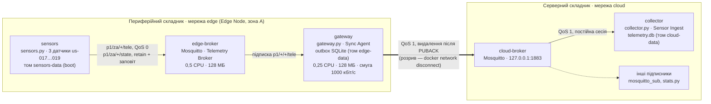
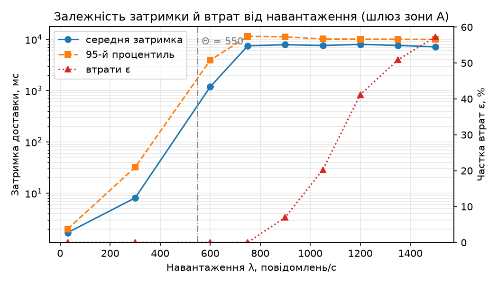

# ЛР3, заняття 2. Розподілене розгортання edge–cloud і шаблони

Канал заняття 1 ([telemetry.md](telemetry.md)) розділено на периферійний і серверний складники так, як у поданні розгортання ЛР1 ([deployment.mmd](diagrams/deployment.mmd)). Сенсори, Telemetry Broker і шлюз (Sync Agent із Local Event Buffer) працюють на Edge Node парковки. Брокер і підписник — у серверному сегменті. Периферію із сервером з'єднує одна ланка, і її розрив — штатний режим (ЛР1, обмеження C-05; NFR-03).

Вимірювання виконано 2026-11-16 на одному комп'ютері:
- Windows 11, 12 логічних процесорів, Docker Desktop 4.78 (Engine 29.5.3, Compose v5.1.4, WSL 2, 7,5 ГБ пам'яті для Docker);
- Eclipse Mosquitto 2.1.2, Python 3.14.10 у контейнерах, paho-mqtt 2.1.0.

## Складники



| Сервіс | Елемент ЛР1 | Образ | Мережі | Том | Ліміти | Призначення |
|---|---|---|---|---|---|---|
| `sensors` | Ultrasonic Sensors, Sensor Controllers | Спільний образ `python:3.14-slim` + paho-mqtt | `edge` | `sensors-data` — лічильник `boot` | — (емулятор пристроїв) | Три датчики зони A, `HZ` на датчик |
| `edge-broker` | Telemetry Broker | `eclipse-mosquitto:2` | `edge` | — | 0,5 CPU, 128 МБ | Брокер периферії; порт не опубліковано |
| `gateway` | Sync Agent + Local Event Buffer | Спільний образ | `edge`, `cloud` — **єдиний** міст між мережами | `edge-data` — буфер `outbox.db` | 0,25 CPU, 128 МБ, `UPLINK_KBPS=1000`, `MAX_ROWS=50000` | Буферизація на периферії |
| `cloud-broker` | Серверний брокер (приймання телеметрії) | `eclipse-mosquitto:2` | `cloud` | — | — | Порт лише `127.0.0.1:1883` |
| `collector` | Sensor Ingest → Metadata DB | Спільний образ | `cloud` | `cloud-data` — `telemetry.db` | — | Перевірка схеми, дублікати, пропуски |

**Чому такі ліміти.** Edge Node у ЛР1 має 16 CPU і 64 ГБ ОЗП (припущення A-03), але майже весь процесор і GPU забирають Video Analytics і LPR Service, а NFR-02 обмежує завантаження вузла ρ ≤ 0,7. Телеметрії виділено малу частку вузла: 0,5 CPU брокеру й 0,25 CPU шлюзу, тобто ≈ 5 % вузла. Ліміт пам'яті 128 МБ дає запас ≈ 6 разів до виміряних пікових 22,5 МіБ (табл. нижче). Брокер периферії не має опублікованого порту: до нього підключаються лише контейнери мережі `edge`.

**Чому ланку обмежено 1000 кбіт/с.** У ЛР1 телеметрія потребує 0,17 Мбіт/с каналу WAN (requirements, 6.4), а Sync Agent обмежено 60 Мбіт/с на весь трафік. Для телеметрії зарезервовано 1 Мбіт/с — у ≈ 6 разів більше за потребу. Мережа між контейнерами на одному комп'ютері майже не обмежена, тож смугу моделює `UPLINK_KBPS`, як смугу браузера в ЛР2. За s ≈ 124 Б (тема й тіло, [telemetry.md](telemetry.md)) пропускна здатність ланки μ1 = R / (8 · s) = 10⁶ / (8 · 124) ≈ 1008 повідомлень/с.

**Місткість буфера за (4).** Vбуф = r · s · Tрозр. Для трьох датчиків зони r = 3 повідомлення/с, тож `MAX_ROWS = 50 000` переносить розрив до 50 000 / 3 = 16 667 с ≈ 4,6 год. Обсяг Vбуф ≈ 50 000 · 124 Б ≈ 6,2 МБ даних, із накладними витратами SQLite — ≈ 8 МБ на диску. NFR-03 вимагає пережити 30 хв, тож запас ≈ 9 разів. Розрахунок для всієї парковки — у розділі «Масштабованість».

**Відмінності від цільової архітектури ЛР1:**
- ланка Sync Agent → сервер тут MQTT QoS 1, а в ЛР1 — HTTPS з ідемпотентними `event_id` (ADR-0002). Шаблон той самий: запис у буфер, підтвердження (PUBACK замість HTTP 200), видалення після підтвердження, ідемпотентний ключ (`dev`, `boot`, `seq`) замість `event_id`;
- немає TLS і облікових записів пристроїв, бо брокери недоступні з мережі;
- сховище сервера — SQLite замість Metadata DB.

**Перевірка запуску** (`docker compose up -d --build`):

```text
$ docker compose ps --format '{{.Service}}: {{.Status}}'
cloud-broker: Up 13 seconds
collector: Up 12 seconds
edge-broker: Up 13 seconds
gateway: Up 12 seconds
sensors: Up 12 seconds
$ docker compose logs --tail 1 gateway
gateway-1  | буфер=1 відкинуто=0 зв’язок=так
$ docker compose exec -T collector python stats.py
boot rate sent received loss late dup lat_mean_ms lat_p95_ms lat_max_ms
   1  3.1   40       40  0.0    0   0         1.7          2          3
Відхилено: 0
```

`буфер=1` — запис, який шлюз щойно отримав і ще не надіслав: у журналі значення фіксується до надсилання.

| Контейнер | Штатний режим, λ = 3 повідомлення/с: CPU / пам'ять | λ = 300 повідомлень/с: CPU / пам'ять | Пікові значення за навантажувальне випробування |
|---|---|---|---|
| `gateway` | 0,40 % / 15,5 МіБ | 24,3 % / 16,2 МіБ | 26,9 % / 22,5 МіБ |
| `edge-broker` | 0,09 % / 3,7 МіБ | 3,7 % / 4,0 МіБ | 8,7 % / 4,3 МіБ |
| `collector` | 0,17 % / 17,8 МіБ | 8,9 % / 18,2 МіБ | 24,8 % / 22,7 МіБ |
| `cloud-broker` | 0,13 % / 3,7 МіБ | 4,6 % / 3,9 МіБ | 5,7 % / 4,4 МіБ |
| `sensors` | 0,14 % / 15,3 МіБ | 13,1 % / 15,8 МіБ | 45,7 % / 17,2 МіБ |

CPU у `docker stats` — частка одного ядра, тож ліміт шлюзу 0,25 CPU відповідає 25 %.

## Шаблони

| Шаблон | Задача в системі | Реалізація | Як перевірено | Результат |
|---|---|---|---|---|
| Публікація — підписка | Нові споживачі телеметрії без змін у датчиках | Теми `p1/{зона}/{пристрій}/{tele\|state}`, підписка з `+`; стан — збережене повідомлення й заповіт | Два нові підписники без змін `sensors.py` і `collector.py` | Обидва отримали дані одразу; заповіт `offline` за 31 с (FR-09) |
| Буферизація на периферії | Розрив ланки периферія — сервер без утрати даних (NFR-03) | `gateway.py`: буфер SQLite (WAL), QoS 1, видалення після PUBACK, найстаріші відкидаються при переповненні | Розрив на 60 с за λ = 300 повідомлень/с | ε = 0; вивантаження 30,7 с проти 26 с за (5) |
| Кероване зниження якості | Брак смуги чи процесора шлюзу за λ > Θ | Спроєктовано драбину режимів Р0/Р1 з порогами й гістерезисом; у коді не реалізовано | Оцінено за даними навантажувального випробування | Р1 знижує λ для всієї парковки з 600 до ≈ 160 повідомлень/с у піку |

### Публікація — підписка

- **Контекст.** Телеметрію датчиків місць споживають кілька складників ЛР1: Sensor Ingest, Occupancy Fusion (об'єднання з відео, FR-02), Information Board (лічильники зон, FR-05), Local Metrics і Device Registry (доступність, FR-09). Їхній склад змінюватиметься: у ЛР4 додасться модель ONNX.
- **Задача.** Додавати й прибирати споживачів, не змінюючи прошивки датчиків і не знаючи наперед, скільки їх.
- **Сили:**
  - датчики дешеві й не мають знати адрес споживачів;
  - стан пристрою має бути відомий новому споживачеві одразу, а не через секунду чи хвилину;
  - брокер стає складником, через який іде весь потік, — і потенційною точкою відмови.
- **Розв'язок.**
  - Датчик публікує в тему `p1/{зона}/{пристрій}/tele`, а споживач підписується шаблоном (`p1/+/+/tele` — уся парковка, `p1/za/#` — одна зона).
  - Стан `online` — збережене повідомлення.
  - `offline` публікує сам брокер як заповіт: одразу, якщо з'єднання закрито без DISCONNECT, і через 1,5 · Keep Alive = 30 с, якщо пристрій завис.
- **Наслідки:**
  - Додати споживача — одна підписка. Перевірка кроку 6: серверний `mosquitto_sub -t 'p1/+/+/tele' -C 3` отримав три покази, а новий підписник периферії `mosquitto_sub -t 'p1/+/+/state' -W 2` одразу отримав три збережені `online` і через 2 с — `Timed out`. Сенсори й `collector.py` не змінювалися.
  - Брокер — спільна залежність: його перезапуск на ≈ 3 с забрав 46 показів QoS 0 ([telemetry.md](telemetry.md), рядок 18).
  - Ресурси брокера малі: пік 8,7 % CPU і 4,3 МіБ за 1500 повідомлень/с.

```text
$ docker compose exec -T cloud-broker mosquitto_sub -t 'p1/+/+/tele' -v -C 3
p1/za/us-017/tele {"dev":"za-us-017","boot":1,"seq":26,"ts":"2026-11-16T13:48:03.101Z","qty":"dist","val":2495,"unit":"mm"}
p1/za/us-018/tele {"dev":"za-us-018","boot":1,"seq":26,"ts":"2026-11-16T13:48:03.434Z","qty":"dist","val":2493,"unit":"mm"}
p1/za/us-019/tele {"dev":"za-us-019","boot":1,"seq":26,"ts":"2026-11-16T13:48:03.768Z","qty":"dist","val":989,"unit":"mm"}
$ docker compose exec -T edge-broker mosquitto_sub -t 'p1/+/+/state' -v -W 2
p1/za/us-017/state online
p1/za/us-018/state online
p1/za/us-019/state online
Timed out
```

Показ `989` датчика `us-019` — зайняте місце A-019 (відстань до даху авто).

### Буферизація на периферії (store-and-forward)

- **Контекст.** Ланка Edge Node — сервер проходить через WAN з доступністю 99,5 % (A-04), тобто до ≈ 3,6 год простою на місяць. NFR-03 вимагає пережити розрив до 30 хв без утрати подій.
- **Задача.** Перенести через розрив усі покази й після відновлення доставити їх без утрат і без дублікатів у базі.
- **Сили:**
  - PUBACK підтверджує лише отримання серверним брокером, а не запис у базу;
  - QoS 1 гарантує «щонайменше один раз», тож після розриву можливі дублікати;
  - буфер у пам'яті не переживе перезапуску шлюзу, а на диску займає місце й ресурс SSD;
  - під час вивантаження нові покази не зупиняються, тож на вивантаження лишається лише надлишок пропускної здатності (5);
  - місткість скінченна, і треба вирішити, що втрачати при переповненні.
- **Розв'язок:**
  1. Шлюз записує кожне отримане повідомлення в `outbox` (SQLite, WAL, `synchronous=NORMAL`) до надсилання.
  2. Надсилає найстаріші пачками по 100 із QoS 1.
  3. Видаляє лише записи, на які прийшов PUBACK.
  4. Переповнений буфер відкидає найстаріші покази: свіжий стан місця цінніший за давній.
  5. Дублікати відкидає підписник за первинним ключем (`dev`, `boot`, `seq`).
- **Наслідки.** Розрив на 60 с пережито з ε = 0 (розділ «Розрив зв’язку»). Ціна:
  - затримка показів із розриву — до 61,8 с;
  - 100 дублікатів (одна пачка без PUBACK);
  - запис на диск кожного показу;
  - шлюз помічає розрив лише через 16 с: Keep Alive 10 с плюс очікування відповіді. Весь цей час він надсилає в «мертве» з'єднання, але нічого не губить, бо записи без PUBACK лишаються в буфері.

### Кероване зниження якості (спроєктовано, не реалізовано)

Навантажувальне випробування показало, що за λ > Θ черга росте, а після переповнення буфера втрачаються найстаріші покази без розбору. Для парковки потрібна драбина режимів, керована заповненістю буфера b = backlog / `MAX_ROWS`:

| Режим | Що надсилається | λ для всієї парковки (500 датчиків) | Вхід у режим | Вихід із режиму |
|---|---|---:|---|---|
| Р0 — повний | Кожен відлік D-05 (1 Гц) + події D-06 | 500 + ≤ 100 = 600 повідомлень/с | — | — |
| Р1 — події | Лише події зміни стану D-06 і heartbeat кожні 10 с; періодичні відліки — хвилинними агрегатами (мін/макс/середнє) | ≤ 100 + 50 + 8,3 ≈ 160 повідомлень/с у піку | b ≥ 0,5 | b ≤ 0,1 і λ < 0,6 · Θ протягом 60 с |

Події D-06 не відкидаються в жодному режимі: вони несуть зміну стану місця (FR-01, FR-05). Широкий гістерезис (0,5 / 0,1) і витримка 60 с не дають режимові «пульсувати» на межі. Реалізацію відкладено: за пакетної публікації ЛР1 (табл. 6.3) потрібне навантаження вже нижче за Θ (розділ «Масштабованість»), тож Р1 — запобіжник на випадок деградації ланки, а не робочий режим.

## Розрив зв’язку

**Методика.** Як у кроці 6 методички:
1. Потік збільшено до λ = 3 · 100 = 300 повідомлень/с (`HZ=100 docker compose up -d sensors`).
2. Через 10 с шлюз відключено від мережі `cloud` на 60 с (`docker network disconnect mmss_cloud mmss-gateway-1`), потім підключено знову.
3. Ще 60 с на вивантаження.
4. Знято журнал шлюзу з мітками часу, зупинено сенсори й отримано підсумок підписника.

Розрив о 13:48:32, відновлення о 13:49:32 (UTC):

```text
gateway-1 | 2026-11-16T13:48:34.331Z буфер=1 відкинуто=0 зв’язок=так
gateway-1 | 2026-11-16T13:48:36.338Z буфер=601 відкинуто=0 зв’язок=так
...
gateway-1 | 2026-11-16T13:48:46.376Z буфер=4215 відкинуто=0 зв’язок=так
gateway-1 | 2026-11-16T13:48:48.377Z буфер=4816 відкинуто=0 зв’язок=ні
...
gateway-1 | 2026-11-16T13:49:32.481Z буфер=18047 відкинуто=0 зв’язок=ні
gateway-1 | 2026-11-16T13:49:34.581Z буфер=18446 відкинуто=0 зв’язок=так
gateway-1 | 2026-11-16T13:49:46.877Z буфер=11336 відкинуто=0 зв’язок=так
...
gateway-1 | 2026-11-16T13:50:03.264Z буфер=1453 відкинуто=0 зв’язок=так
gateway-1 | 2026-11-16T13:50:05.268Z буфер=4 відкинуто=0 зв’язок=так

# підсумок підписника (docker compose exec -T collector python stats.py):
boot  rate  sent received loss late dup lat_mean_ms lat_p95_ms lat_max_ms
   2 300.0 40270    40270  0.0    0 100     21663.0      57542      61839
```

| Величина | Прогноз | Виміряно |
|---|---|---|
| Зростання буфера під час розриву | λ = 300 записів/с | ≈ 300 записів/с (601 за 2 с) |
| Виявлення розриву шлюзом | ≤ 1,5–2 · Keep Alive = 15–20 с | 16 с (13:48:32 → 13:48:48) |
| Q0 на момент відновлення | 300 · 60 ≈ 18 000 | ≈ 18 450 |
| μ1 — пропускна здатність ланки | 10⁶ / (8 · 124) ≈ 1008 повідомлень/с | 300 + 592 ≈ 890 повідомлень/с (на лінійній ділянці буфер спадав на 592 записи/с) |
| Час вивантаження за (5): Tрозв = Q0 / (μ1 − λ) | 18 450 / (1008 − 300) ≈ 26 с | 30,7 с (13:49:34,6 → 13:50:05,3) |
| Утрати ε | 0 | 0 (40 270 = 40 270) |
| Дублікати | ≤ BATCH = 100 | 100 |
| Найбільша затримка | ≈ Tрозр + Tрозв | 61,8 с |

Виміряний час вивантаження на 18 % більший за прогноз, бо μ1 менша за 1008. Шлюз на 0,25 CPU одночасно приймає й записує нові 300 повідомлень/с і не завжди встигає витримати бюджет смуги для пачки 100 записів (99 мс). Без вхідного потоку буфер спорожнявся на 986–1000 записів/с, тобто точно зі смугою ланки (розділ «Навантаження»). За μ1 = 890 формула (5) дає 18 450 / 590 ≈ 31 с, що збігається з виміряним.

Позначка `зв’язок=ні` з'являється не одразу. Мережу відключено, але TCP-з'єднання на боці шлюзу ще «живе». paho-mqtt надсилає PINGREQ через Keep Alive = 10 с і чекає відповіді ще стільки ж. Ці 16 с шлюз публікує в «мертве» з'єднання, але нічого не губить: записи без PUBACK лишаються в буфері, а 100 із них (пачка на момент розриву) після відновлення пішли вдруге й стали дублікатами. Підписник відкинув їх за первинним ключем.

**Постійна сесія підписника** — перевірка пастки «PUBACK ≠ доставка». Шлюз отримує PUBACK від серверного брокера, а не від підписника. Підписник із постійною сесією (`clean_session=False`) зупиняли, коли шлюз працював:

| Прогін | λ, повідомлень/с | Підписник не працював | Повідомлень за цей час | Утрачено | Причина |
|---|---:|---:|---:|---:|---|
| boot 3 | 3 | 33 с | ≈ 100 | 0 (133 з 133) | Брокер тримав їх у черзі постійної сесії |
| boot 4 | 300 | ≈ 13 с | ≈ 3900 | 2335 (ε = 0,229) | Черга брокера `max_queued_messages` = 1000 переповнилася: `Outgoing messages are being dropped for client collector` |

Шлюз в обох прогонах мав порожній буфер і `відкинуто=0`: для нього все доставлено. Тому для цільової системи потрібні:
- `max_queued_messages` ≥ λ · Tперезапуску підписника (для парковки 150 повідомлень/с · 120 с = 18 000);
- `persistence true` на серверному брокері;
- або підтвердження після запису в базу (HTTP 200 від Parking API, як у ADR-0002).

Рішення зафіксовано в [ADR-0005](adr/0005-telemetry-patterns.md).

**Додатково: міст Mosquitto замість власного шлюзу.** Методичка пропонує порівняти шлюз із мостом Mosquitto (`connection`, `persistence true`). Сценарій [smart/bridgetest.sh](../smart/bridgetest.sh) повторює той самий розрив: λ = 300 повідомлень/с, 60 с без мережі `cloud`, 60 с на вивантаження. Брокер периферії підключено до обох мереж ([docker-compose.bridge.yml](../smart/docker-compose.bridge.yml)), а `gateway` не запускається. Порівнювалися два варіанти:
- А — звичайний міст ([bridge.conf](../smart/broker/bridge.conf)): `topic p1/+/+/tele out 1`, `cleansession false`, `persistence true`, `max_queued_messages 50000`;
- Б — те саме плюс `upgrade_outgoing_qos true` ([bridge-qos1.conf](../smart/broker/bridge-qos1.conf)), щоб покази QoS 0 від датчиків ішли мостом із QoS 1 і ставилися в чергу.

| Показник | Шлюз `gateway.py` | Міст, варіант А | Міст, варіант Б (QoS 1) |
|---|---:|---:|---:|
| Nнад / Nотр | 40 270 / 40 270 | 39 818 / 20 487 | 39 873 / 25 500 |
| Утрати ε | **0** | 0,486 (19 331) | 0,361 (14 373); у двох повторах — 0,376 і 0,330 |
| Дублікати | 100 | 0 | 0 |
| Lд сер. / p95 / max, мс | 21 663 / 57 542 / 61 839 | 15 / 37 / 59 | 8 253 / 61 165 / 65 732 |
| Пам'ять брокера периферії на 30-й с розриву | — (буфер на диску; шлюз 16–22 МіБ) | 4,4 МіБ — черги немає | 9,4 МіБ — черга в пам'яті |
| Обмеження швидкості вивантаження | 1000 кбіт/с | Немає | Немає |

Чому міст утрачає дані (діагностичні прогони з розкладом отриманих показів за часом вимірювання):
- **Варіант А.** Брокер не ставить у чергу повідомлення QoS 0 для від'єднаного клієнта, і міст тут не виняток. Утрачено все від початку розриву до перепідключення моста (≈ 64 с · 300 ≈ 19 200), виміряно 19 331. Затримка отриманих показів мала, бо запізнілих немає — вони просто зникли.
- **Варіант Б.** Черга працює: пам'ять брокера зросла з 4,4 до 9,4 МіБ, покази з розриву дійшли із затримкою, що лінійно спадає від 57 до 4 с. Але дійшло лише ≈ 20 % показів кожних 5 с розриву. Причина — в журналі серверного брокера рівно в момент перепідключення моста: `Outgoing messages are being dropped for client collector`. Міст вивантажує накопичені ≈ 18 000 повідомлень без обмеження швидкості. Серверний брокер приймає їх і підтверджує PUBACK, а черга підписника (`max_queued_messages` = 1000) переповнюється. Для моста все доставлено.

**Висновок порівняння.** Шлюз виграє не лише стійким буфером на диску й керованим переповненням (відкидає найстаріші). Обмеження смуги працює як зворотний тиск: шлюз вивантажує ≈ 590 записів/с понад вхідний потік, і підписник встигає. Міст такого механізму не має: варіант Б губить дані не на ланці, а на наступному кроці, і це видно лише за `seq` у базі. Висновок підтримує варіант В в [ADR-0005](adr/0005-telemetry-patterns.md).

Перший прогін цього порівняння дав хибні числа: утрати 6,7–13,1 % і ≈ 21 000 дублікатів. Виявилося, що контейнер `gateway`, який лишився після `bottleneck.sh`, продовжував працювати. Команда `docker compose down` із файлом-перевизначенням не зупиняє сервіс з неактивним профілем, тож покази йшли двома шляхами. Сценарій виправлено: він зупиняє все розгортання основним файлом і перевіряє, що `gateway` не працює. Числа вище — з повторного чистого прогону.

## Навантаження

**Методика.** [smart/loadtest.sh](../smart/loadtest.sh) перезапускає систему з чистими томами й `MAX_ROWS=10000`. Далі дев'ять ступенів по 30 с: λ = 3 · HZ від 30 до 1500 повідомлень/с. Після кожного ступеня сценарій чекає, поки буфер спорожніє; кожен ступінь — окремий запуск емулятора, тобто рядок `stats.py`. Під час прогону `docker stats` знімався кожні 2–4 с. Журнал шлюзу з мітками часу збережено в [results/load_gateway.log](../results/load_gateway.log). Із нього за швидкістю зростання буфера обчислено фактичну пропускну здатність шлюзу на кожному ступені: Θ(λ) = λ − dQ/dt.

Результати ([results/load.csv](../results/load.csv), Θ ≈ 550 повідомлень/с — визначення нижче):

| λ, повідомлень/с | Nнад | Nотр | ε | Lд сер., мс | p95, мс | max, мс | u = λ / Θ | Θ(λ) за журналом | Пік буфера | Відкинуто шлюзом |
|---:|---:|---:|---:|---:|---:|---:|---:|---:|---:|---:|
| 30 | 900 | 900 | 0 | 1,7 | 2 | 21 | 0,05 | — | 1 | 0 |
| 300 | 9 000 | 9 000 | 0 | 8,1 | 32 | 77 | 0,55 | — | 1 | 0 |
| 600 | 18 000 | 18 000 | 0 | 1 185 | 3 915 | 4 201 | 1,09 | 515 | 2 368 | 0 |
| 750 | 22 500 | 22 500 | 0 | 7 451 | 11 433 | 11 684 | 1,36 | 450 | 8 426 | 0 |
| 900 | 27 000 | 25 110 | 0,070 | 7 855 | 11 175 | 11 429 | 1,64 | 495 | 10 000 | 1 890 |
| 1050 | 31 500 | 25 129 | 0,202 | 7 568 | 10 132 | 10 233 | 1,91 | 482 | 10 000 | 6 371 |
| 1200 | 36 000 | 21 168 | 0,412 | 7 973 | 10 078 | 10 285 | 2,18 | 342 | 10 000 | 14 832 |
| 1350 | 40 500 | 19 902 | 0,509 | 7 596 | 10 016 | 10 297 | 2,45 | 341 | 10 000 | 20 598 |
| 1500 | 45 000 | 19 219 | 0,573 | 7 121 | 9 920 | 10 255 | 2,73 | 266 | 10 000 | 25 781 |



*Рис. — Залежність затримки доставки й частки втрат від навантаження (results/latency.png).*

**Визначення Θ.** Три незалежні способи дають Θ ≈ 550 повідомлень/с:
1. **Ступені.** На λ = 300 буфер не ріс. На 600 ріс на 85 записів/с, тож Θ(600) ≈ 515. Додаткові ступені [bottleneck.csv](../results/bottleneck.csv) уточнили межу: на 450 і 540 буфер не перевищив 18 і 53 записи, а середня затримка трималася 15–20 мс. Отже, Θ лежить між 540 і 600.
2. **Утрати.** Буфер переповнюється за ступінь, коли (λ − Θ) · 30 > 10 000. За Θ(λ) із журналу прогноз утрат (λ − Θ(λ)) · 30 − 10 000 дає 2 150 / 7 040 / 15 740 / 20 270 / 27 020 на ступенях 900–1500. Виміряно 1 890 / 6 371 / 14 832 / 20 598 / 25 781: розбіжність ≤ 14 %. Лічильник `відкинуто` шлюзу (69 472 разом) **точно** дорівнює сумі втрат, які виявив підписник за `seq`: 1 890 + 6 371 + 14 832 + 20 598 + 25 781 = 69 472.
3. **Найбільша затримка.** За λ > Θ вона обмежена місткістю буфера, а не тривалістю ступеня. Найстаріші записи відкидаються, а після ступеня буфер спорожняється на ≈ 1000 записів/с, тож Lmax ≈ `MAX_ROWS` / 1000 ≈ 10 с. Виміряно 10,2–11,7 с.

**Поведінка біля Θ.** До u ≈ 0,55 затримка — одиниці мілісекунд (p95 ≤ 32 мс). Біля Θ вона стрибає: на 540 — 20 мс, на 600 (u = 1,09) — 1,2 с середня й 3,9 с p95. Це очікувана картина з моделі M/M/1 (W = 1 / (μ − λ) → ∞ за λ → μ). Далі черга росте на λ − Θ записів щосекунди, поки буфер не переповниться, і з λ = 900 з'являються втрати.

**Вузьке місце — процесор шлюзу.** Висновок спирається на чотири спостереження:
- **`docker stats`.** На ступенях 600–1500 `gateway` тримався на 24–27 % CPU за ліміту 25 %. `edge-broker` — ≤ 8,7 % із дозволених 50 %, `cloud-broker` — ≤ 5,7 %, `collector` — ≤ 24,8 % без ліміту. Пам'ять жодного контейнера не перевищила 23 МіБ.
- **Θ залежить від λ.** Вона падає з 515 до 266, коли λ зростає з 600 до 1500. Отже, ресурс, який обмежує шлюз, витрачається і на приймання нових повідомлень (запис у `outbox`), і на надсилання. Це процесор, а не смуга: смуга не залежить від вхідного потоку.
- **Без вхідного потоку** (після кожного ступеня) буфер спорожнявся на 986–1000 записів/с, точно за смугою ланки μ1 = 10⁶ / (8 · 124) ≈ 1008. Смуга — друге вузьке місце, яке проявляється, коли процесора досить.
- **Контрольний експеримент** [smart/bottleneck.sh](../smart/bottleneck.sh) на λ = 900 (таблиця нижче).

| Конфігурація | Смуга, кбіт/с | CPU шлюзу | λ, повідомлень/с | Пік буфера | Nотр / Nнад | ε | Lд сер. / p95 / max, мс | Висновок |
|---|---:|---:|---:|---:|---:|---:|---|---|
| A — як у випробуванні | 1000 | 0,25 | 900 | 10 000 | 24 786 / 27 000 | 0,082 | 8002 / 11 502 / 11 659 | Перевантаження |
| B — смуга не обмежена | — | 0,25 | 900 | 10 000 | 24 735 / 27 000 | 0,084 | 7830 / 11 194 / 11 468 | Те саме: **смуга не обмежує** |
| C — більше процесора | 1000 | 1,0 | 900 | 24 | 27 000 / 27 000 | 0 | 18,7 / 41 / 77 | Буфер не росте: **обмежує процесор** |
| D — уточнення Θ | 1000 | 0,25 | 450 | 18 | 13 500 / 13 500 | 0 | 15,3 / 42 / 76 | Нижче Θ |
| E — уточнення Θ | 1000 | 0,25 | 540 | 53 | 16 200 / 16 200 | 0 | 19,5 / 45 / 109 | Ще нижче Θ; на 600 буфер уже росте |

Сценарій запускався двічі. Перший прогін перервав сон комп'ютера між A і B: B стартував одразу після пробудження, і емулятор видав лише 685 повідомлень/с замість 900. Тому в CSV — повний повторний прогін; висновки обох прогонів збігаються (у першому C: пік 40, ε = 0).

Θ шлюзу на 0,25 CPU ≈ 550 повідомлень/с, на 1 CPU — щонайменше 900 (вище перевірити не дає смуга: 900 / 1008 ≈ 0,89). Отже, процесор — перше вузьке місце, а смуга ланки — друге.

Процесор як метрика навантаження шлюзу оманливий. Головний цикл без пауз опитує буфер, доки в ньому є записи, тож `docker stats` показує ≈ 25 % навіть на λ = 300, де буфер не росте. Справжній показник завантаження — `буфер` у журналі шлюзу, і саме його спостерігає технічна служба (Local Metrics).

## Масштабованість

**Яке навантаження потрібне системі.** Розрахунок за реєстром даних і NFR ЛР1:

| Сценарій | Розрахунок λ | λ, повідомлень/с | u = λ / Θ (Θ ≈ 550) | Запас Θ / λ |
|---|---|---:|---:|---:|
| Прототип: 3 датчики зони A | 3 · 1 Гц | 3 | 0,005 | ≈ 180 |
| Уся парковка, кожен датчик окремо (як у прототипі) | 500 · 1 Гц (D-05) + ≤ 100 подій/с у піку (D-06) | 600 | 1,09 | 0,9 — **не вистачає** |
| Уся парковка, пакети Sensor Controllers (ЛР1, табл. 6.3) | 50 контролерів · 1 Гц + ≤ 100 подій/с | 150 | 0,27 | ≈ 3,7 |
| Одна зона (100 місць), пакети | 10 · 1 Гц + ≤ 20 подій/с | 30 | 0,05 | ≈ 18 |

Висновок:
- Схема прототипу «окреме повідомлення від кожного датчика» на шлюзі з 0,25 CPU для всієї парковки не підходить: u > 1, і буфер росте безупинно.
- Пакетна публікація з ЛР1 зменшує λ у 4 рази й дає запас 3,7.
- Вимірювання підтверджують рішення ЛР1 про пакетування: раніше воно обґрунтовувалося лише службовими байтами (×3,9 → ×1,29), тепер — ще й пропускною здатністю шлюзу.

**Буфер для всієї парковки за (4)** — розрив 30 хв (NFR-03), пакети JSON по 10 відліків. Оцінка s ≈ 700 Б: вдвічі більше за Protobuf-пакет 320 Б плюс тема:
- Vбуф = r · s · Tрозр = 50 · 700 · 1800 ≈ 63 МБ, тобто 90 000 записів;
- з Protobuf (s ≈ 340 Б із темою) — ≈ 31 МБ;
- для окремих повідомлень від кожного датчика — 500 · 124 · 1800 ≈ 112 МБ (900 000 записів);
- отже, `MAX_ROWS` для цільової парковки ≥ 100 000 записів-пакетів. Це < 0,1 % SSD 256 ГБ Edge Node.

**Вивантаження за (5) після розриву 30 хв.** NFR-03 вимагає синхронізувати події за ≤ 120 с.
- Пакети JSON (s ≈ 700 Б) на смузі 1 Мбіт/с: μ1 = 10⁶ / (8 · 700) ≈ 179 пакетів/с і Tрозв = 90 000 / (179 − 50) ≈ 700 с ≈ 12 хв — у 6 разів довше за вимогу.
- Потрібна смуга R = 8 · s · (Q0 / 120 + λ) = 8 · 700 · (750 + 50) ≈ 4,5 Мбіт/с (з Protobuf — ≈ 2,2 Мбіт/с). Це в межах ліміту Sync Agent 60 Мбіт/с, тож для телеметрії резервуємо 5 Мбіт/с замість 1.
- Друга міра — пріоритет подій. Події D-06 у середньому рідкі (≈ 4000 на добу, тобто ≈ 85 за 30 хв), тож якщо надсилати їх першими, NFR-03 виконується навіть на 1 Мбіт/с. Періодичні відліки D-05 доїжджають слідом.

**Що масштабувати першим і як.**
1. **Шлюз — вертикально.** Він вузьке місце (розділ «Навантаження»): 1 CPU замість 0,25 прибрав зростання буфера на λ = 900. Edge Node має 16 CPU, тож це найдешевший крок: +0,75 CPU, ≈ 5 % вузла.
2. **Пакетування на Sensor Controllers** (λ ÷ 4) — уже передбачене ЛР1.
3. **Шлюз — горизонтально, за темами.** Окремий процес шлюзу на зону підписується на `p1/za/+/tele`, `p1/zb/+/tele` тощо. Стан шлюзу (буфер і зв'язок) не спільний, тож процеси незалежні, а Θ зростає пропорційно кількості процесів. Порядок у межах пристрою зберігається, бо всі покази пристрою йдуть через один шлюз.
4. **Ланка** — наступне вузьке місце: без вхідного потоку шлюз упирався в 1000 повідомлень/с. Смугу збільшують до 5 Мбіт/с (див. вище).
5. **Сервер.** Підписників розбивають за темами (лекція 10): `p1/+/+/tele` → кілька екземплярів Sensor Ingest зі спільною підпискою MQTT 5 (`$share/ingest/p1/+/+/tele`) або з розбиттям за зонами. Ідемпотентний ключ (`dev`, `boot`, `seq`) робить це безпечним. Пік `collector` — 24,8 % CPU за 1000 повідомлень/с, тож один екземпляр витримає 150 повідомлень/с парковки з великим запасом.

**Якщо кількість сенсорів зросте в 100 разів** (50 000 датчиків — мережа зі 100 парковок): кожна парковка має власний Edge Node і шлюз. Навантаження на периферію не змінюється (150 повідомлень/с на вузол), а масштабування горизонтальне за природою континууму edge–cloud. Сервер отримує 100 · 150 = 15 000 повідомлень/с. Тоді:
- кластер брокерів або Apache Kafka з розбиттям за парковкою (рівень 1 теми);
- десятки екземплярів Sensor Ingest;
- сховище часових рядів із розбиттям за часом і агрегуванням (сирі 7 діб, агрегати 1 рік, як у реєстрі D-05).

## Мова і стек

| Складник | Вимоги, що визначають вибір | У роботі | Виміряно | Обґрунтування та альтернатива |
|---|---|---|---|---|
| Датчики й Sensor Controllers | Сотні кілобайтів пам'яті, енергія, передбачуваний час опитування 10 Гц | Python — лише емулятор | Емулятор: 15–17 МіБ, до 46 % CPU за 1500 повідомлень/с | На пристрої — C або Rust без збирача сміття (лекція 11); Python — тільки для стенду |
| Брокер периферії (Telemetry Broker) | Мала пам'ять, автономність Edge Node, MQTT 3.1.1/5, заповіти | Eclipse Mosquitto 2.1.2 (C) | 3,7–4,3 МіБ, ≤ 8,7 % CPU за 1500 повідомлень/с | Міст Mosquitto міг би замінити шлюз, але без обмеження швидкості вивантаження й керування переповненням: за розриву 60 с утратив 36–49 % показів (розділ «Розрив зв’язку») |
| Шлюз (Sync Agent) | 24/7, стійкий буфер, 0,25 CPU, Θ ≥ 2 · λ | Python 3.14, paho-mqtt 2.1, SQLite WAL | 15,5–22,5 МіБ; Θ ≈ 550 на 0,25 CPU; ≥ 900 на 1 CPU | Достатньо для пакетної публікації (u ≈ 0,27). Go — якщо окремі повідомлення від датчиків або fog-вузол на кілька парковок ([ADR-0006](adr/0006-gateway-language-stack.md)) |
| Серверний брокер | Багато пристроїв і незалежних підписників, постійні сесії | Eclipse Mosquitto 2.1.2 | 3,7–4,4 МіБ, ≤ 5,7 % CPU; черга сесії 1000 повідомлень | Для 100 парковок і повторного читання історії — Apache Kafka або кластер EMQX (лекція 11) |
| Підписник і сховище (Sensor Ingest → Metadata DB) | Перевірка схеми, ідемпотентний запис, запити за часом | Python, SQLite (WAL, `INSERT OR IGNORE`) | 17,8–22,7 МіБ, ≤ 24,8 % CPU за ≈ 1000 повідомлень/с | Один файл без сервера — досить для прототипу. Для парковки — PostgreSQL/TimescaleDB (Metadata DB ЛР1) і кілька підписників із розбиттям тем |
| Аналітика каналу | Відтворюваність, CSV і графіки | Python: `stats.py`, `plot.py` (matplotlib) | — | Той самий стек, що в ЛР2 |

Рішення для найважливішого складника, шлюзу, зафіксовано в [ADR-0006](adr/0006-gateway-language-stack.md).
